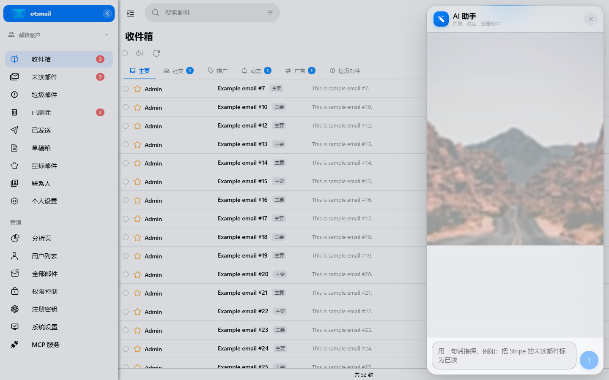
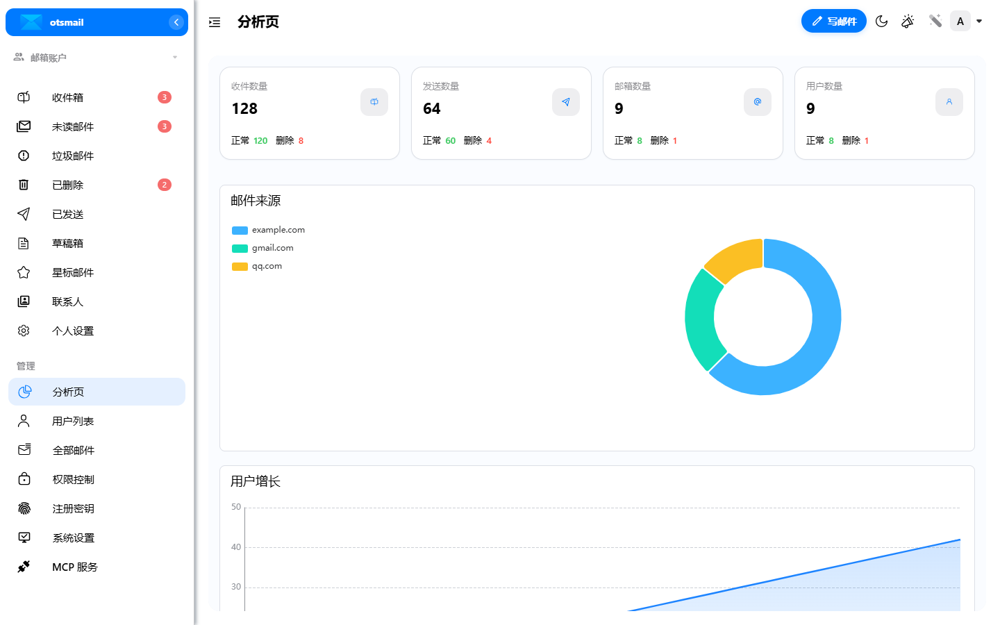
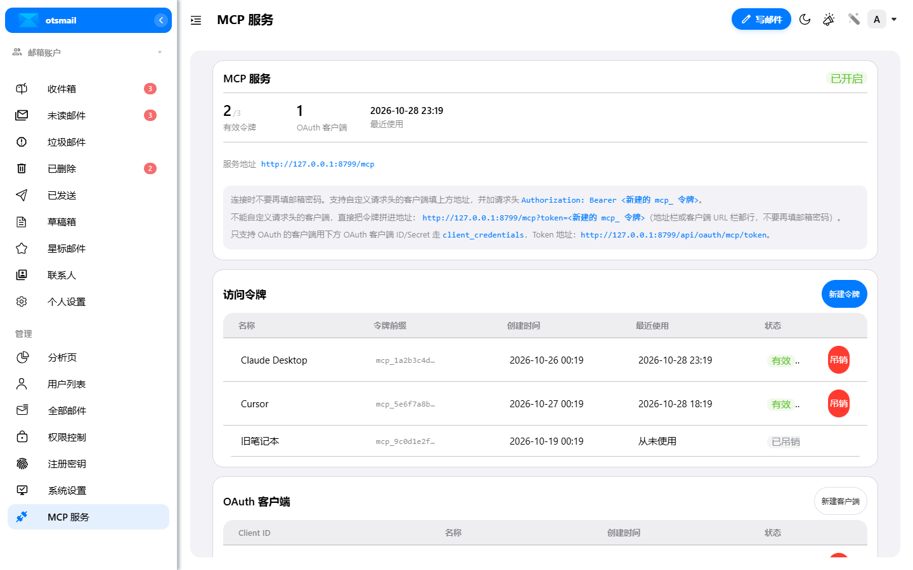

<p align="center">
  
  <h1 align="center">otsmail</h1>
  <p align="center">基于 Cloudflare Workers 的自建邮箱</p>
  <p align="center">
    
    
  </p>
</p>

otsmail 是一个运行在 Cloudflare 上的自建邮箱系统：收件走 Email Routing，发件走 Resend / Cloudflare Email Service，数据存放在 D1、KV 和 R2，不需要自己的服务器。

项目 fork 自 [maillab/cloud-mail](https://github.com/maillab/cloud-mail)，保留其 MIT 协议和 Cloudflare 原生架构，并在此基础上做了安全加固与功能扩展。感谢原作者。

## 相比上游新增或增强的功能

| 功能 | 说明 |
|---|---|
| AI 助手 | 支持 OpenAI 兼容接口，可配置 Base URL、API Key 和模型；支持写信、回复、润色、按自然语言整理邮件；AI 面板支持自定义背景和透明度。 |
| Telegram 管理 | 绑定同一个 Bot 后，可在 Telegram 里查看未读、读信、搜索、标记已读/未读、删除、归档，并直接用自然语言让 AI 操作邮箱。 |
| MCP 服务 | 内置 MCP Server，支持 Bearer Token、查询参数 Token 和 OAuth `client_credentials`；可接入 Claude Desktop、Cursor 等客户端。 |
| 翻译 | 集成 DeepL，可在读信页直接翻译邮件正文。 |
| 通知 | 浏览器桌面通知、提示音和 Web Push；关闭页面后仍可收到新邮件通知。 |
| 邮件分类 | 收件箱分为主要、社交、推广、动态、广告、垃圾邮件；默认使用本地规则，也可切换为自动 AI 分类或手动触发分类。 |
| 子账户 | 支持多邮箱账户，按域名分组展示，可快速切换当前发件账户。 |
| 登录与安全 | 多 OIDC 提供商、登录态绑定、2FA、密码登录强制 2FA；连续 5 次密码错误锁定 15 分钟并通过 Telegram 告警；参数化 SQL、DOMPurify、PBKDF2、CORS 白名单等加固。 |
| 使用体验 | Gmail 风格邮件列表、分页、搜索命中高亮、分类未读计数、快捷已读/删除、移动端适配、原版分析页。 |

## 截图

### 收件箱与分类


### AI 助手



### 分析页



### MCP 服务



## 快速开始

需要 Node.js、pnpm 和 Cloudflare 账号。

### 一键部署（Windows PowerShell，实验性）

先在 `mail-worker` 下安装依赖，然后在仓库根目录执行：

```powershell
cd mail-worker; pnpm install; cd ..
powershell -ExecutionPolicy Bypass -File scripts/install.ps1
```

脚本会提示邮箱域名和管理员邮箱，自动创建独立的 D1 / KV / R2、构建前端、部署 Worker、上传静态资源并初始化数据库。它不会修改现有的 `mail-worker/wrangler.toml`，生成的 `mail-worker/wrangler.oneclick.toml` 已被 gitignore；如果同名资源已存在会直接停止，避免误绑到现有邮箱。

> 运行 otsmail 必须有 D1。目标 Cloudflare 账号无法创建 D1 时，脚本会停在创建数据库这一步；这不会影响已经在运行的其他实例。当前脚本未在无 D1 环境做端到端验证。

### 手动部署

```bash
git clone https://github.com/otscup/otsmail.git
cd otsmail/mail-worker

npx wrangler d1 create otsmail
npx wrangler kv namespace create otsmail-kv
npx wrangler r2 bucket create otsmail-r2
```

把生成的 D1 / KV / R2 ID 填入 `mail-worker/wrangler.toml`，然后设置密钥：

```bash
npx wrangler secret put jwt_secret
npx wrangler deploy
```

首次部署后访问 `https://<你的域名>/api/init/<jwt_secret>` 初始化数据库表。

前端构建：

```bash
cd ../mail-vue
pnpm install
pnpm build
```

构建产物会写入 `mail-worker/dist`，随 Worker 一起部署。生产环境也可以把 `mail-worker/dist` 上传到 R2，由 Worker 直接提供静态资源；本项目当前使用这种方式。

最后在 Cloudflare Dashboard 的 Email Routing 中把 catch-all 指向 `otsmail` Worker，并配置好发件服务。

> 免费 Workers 套餐的 CPU 时间很紧，PBKDF2 轮数请按需调低；付费套餐可以使用默认值。

## 开发

```bash
cd mail-worker && pnpm install && pnpm test
cd mail-vue   && pnpm install && pnpm build
cd mail-worker && npx wrangler deploy --dry-run
```

## 技术栈

Cloudflare Workers · Hono · Drizzle ORM · Vue 3 · Element Plus · D1 · KV · R2 · Resend · DeepL

## License

MIT License，见 [LICENSE](LICENSE)。原项目版权归 [maillab/cloud-mail](https://github.com/maillab/cloud-mail) 作者所有。
