# otsmail

<p align="center">
  
</p>

<p align="center">
  基于 Cloudflare Workers 的自建邮箱：Email Routing 收信，Resend / Cloudflare Email Service 发信，D1 + KV + R2 存储。
</p>

<p align="center">
  
  
  
  
  
</p>

> Fork 自 [maillab/cloud-mail](https://github.com/maillab/cloud-mail)，保留 MIT 协议和 Cloudflare 原生架构，并在其基础上做了安全加固、界面重做和功能扩展。

[](https://deploy.workers.cloudflare.com/?url=https://github.com/otscup/otsmail)

## 界面

收件箱：三栏布局、分类标签、未读计数、批量操作、圆角阅读界面。

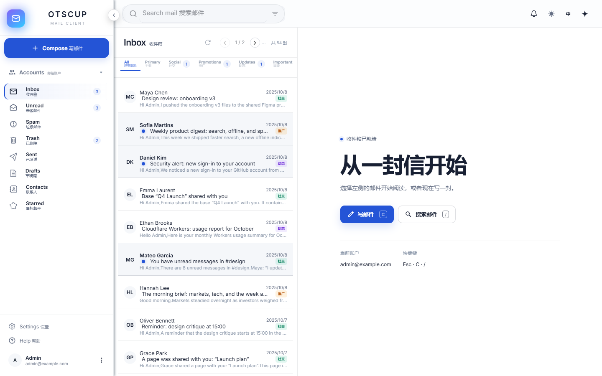

登录页内置 4 套可切换皮肤，入口在 **系统设置 → 个性化 → 登录页皮肤**。

<table>
  <tr>
    <td width="50%">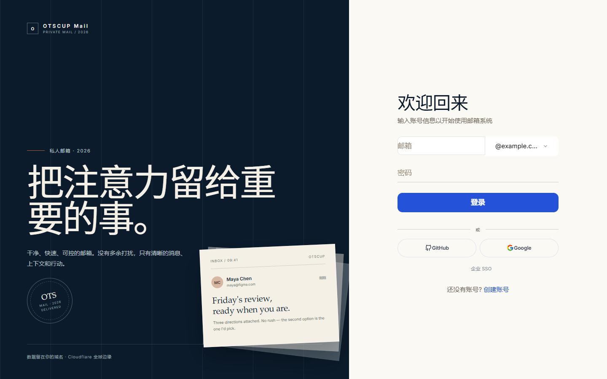</td>
    <td width="50%">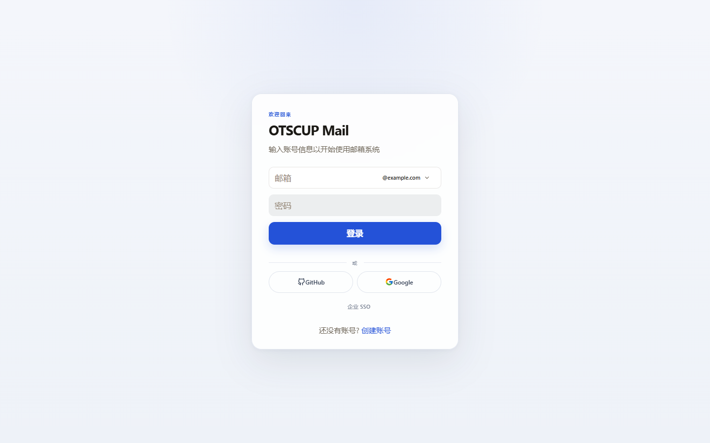</td>
  </tr>
  <tr>
    <td align="center"><b>Paper</b> · 杂志分栏</td>
    <td align="center"><b>Centered</b> · 居中卡片</td>
  </tr>
  <tr>
    <td width="50%">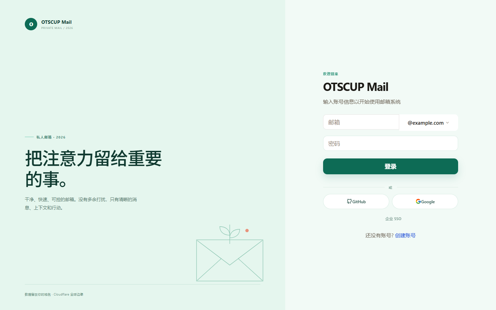</td>
    <td width="50%">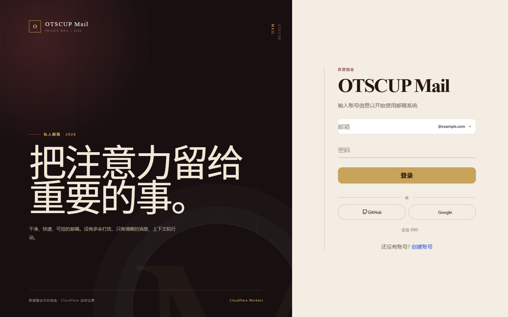</td>
  </tr>
  <tr>
    <td align="center"><b>Fresh</b> · 清晨薄荷</td>
    <td align="center"><b>Gala</b> · 午夜歌剧</td>
  </tr>
</table>

登录后可在 **个人设置 → 个人外观** 切换 Paper / Fresh / Gala；选择会同步到账号，并同时应用到收件箱、阅读器和登录页。

<table>
  <tr>
    <td width="33.33%">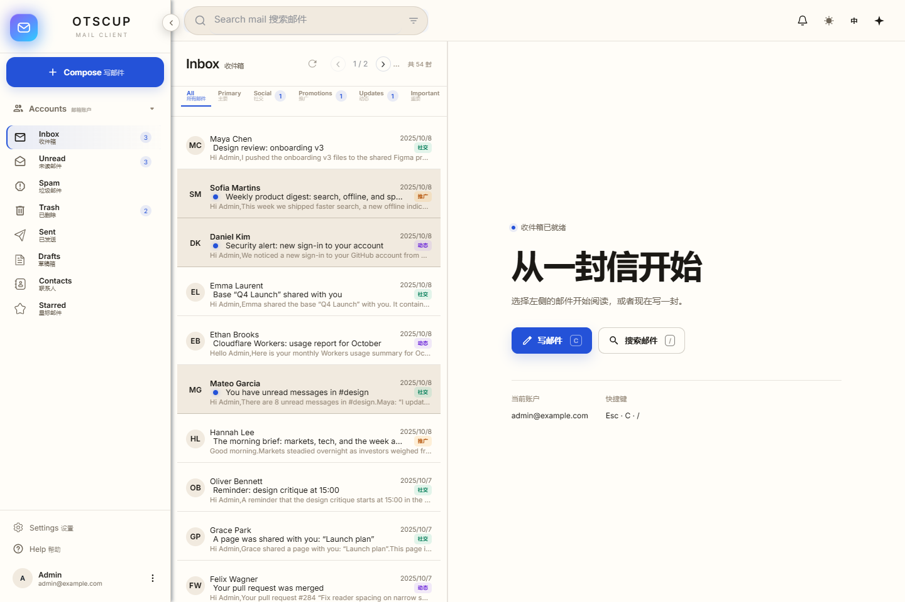</td>
    <td width="33.33%">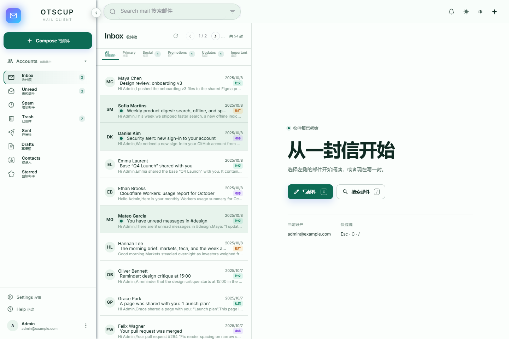</td>
    <td width="33.33%">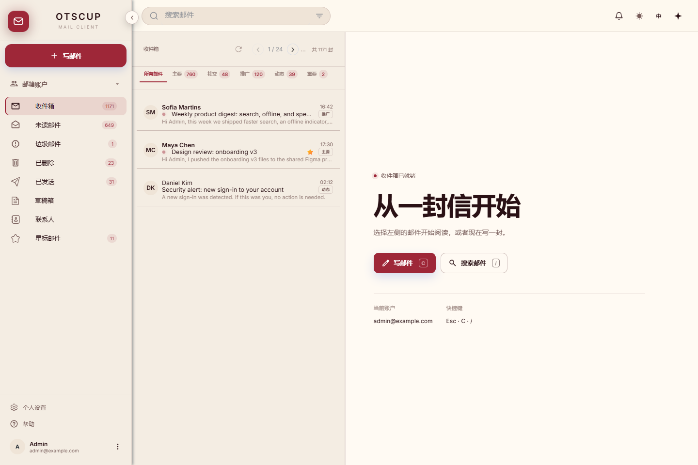</td>
  </tr>
  <tr>
    <td align="center"><b>Paper</b> · 冷纸与靛蓝</td>
    <td align="center"><b>Fresh</b> · 薄荷与松绿</td>
    <td align="center"><b>Gala</b> · 酒红与香槟</td>
  </tr>
</table>

## Android 客户端

仓库：[otscup/otsmail-android](https://github.com/otscup/otsmail-android)

- 下载：[Android Releases](https://github.com/otscup/otsmail-android/releases)
- 客户端不内置服务器地址，首次启动填写你自己的实例地址，例如 `https://mail.example.com`
- 推送需要你自己的 Firebase 项目；配置见下方变量表
- 支持账号密码、2FA、OIDC、收件箱分类、附件、写信、搜索、AI、FCM 推送

<table>
  <tr>
    <td width="50%">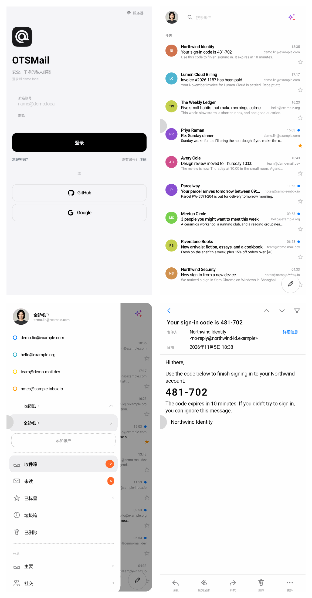</td>
    <td width="50%">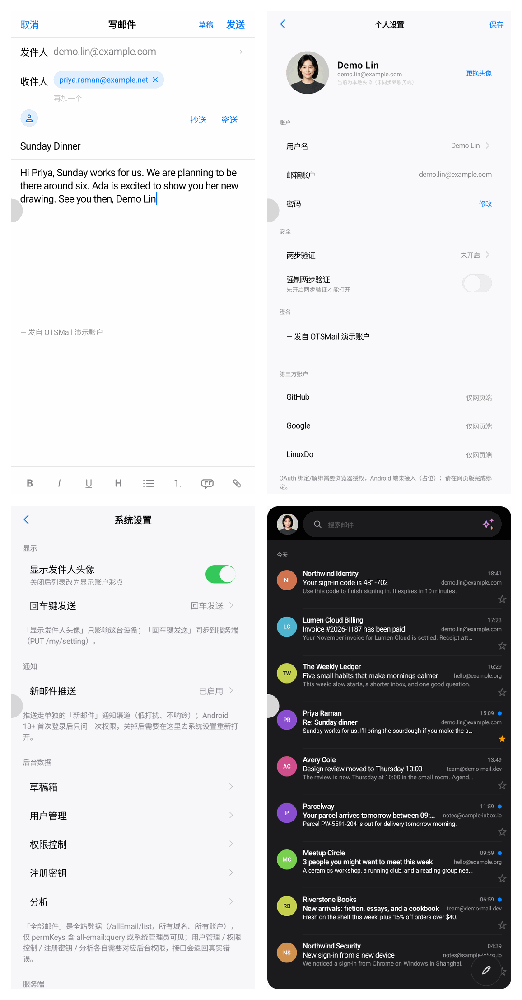</td>
  </tr>
  <tr>
    <td align="center">登录（GitHub / Google）、收件箱、侧边栏、详情</td>
    <td align="center">写信、个人设置、系统设置、深色收件箱</td>
  </tr>
</table>

移动端演示截图使用虚拟数据，不连接任何真实邮箱。

## 功能

| 功能 | 说明 |
|---|---|
| 多邮箱账户 | 同一账号下管理多个邮箱，支持域名、名称、默认发件账户和“所有账户邮件” |
| 邮件列表 | Gmail 风格三栏、分类标签、未读计数、分页、搜索高亮、右键多选和批量操作 |
| 阅读器 | 发件人折叠/展开、回复/回复全部/转发、附件、HTML 安全渲染、深色模式 |
| 登录与账户 | GitHub / Google / LinuxDo / 企业 OIDC 登录，2FA，注册码，登录限速，域名选择 |
| 登录页皮肤 | Paper / Centered / Fresh / Gala 四套模板，后台可切换 |
| AI 助手 | OpenAI 兼容接口，可配置 Base URL / API Key / 模型；支持摘要、翻译、润色、写信和邮件问答 |
| 自动分类 | 本地规则优先，可切换自动 AI 分类或手动分类；支持发件人 + 关键词学习 |
| 通知 | 浏览器桌面通知、Web Push、Android FCM（data-only），右上角铃铛入口 |
| Telegram | 同一 Bot 接收未读、搜索、已读、未读、删除、归档等指令，也支持自然语言 AI 操作 |
| MCP | 内置 MCP Server，支持 Bearer Token、查询参数 Token 和 OAuth `client_credentials` |
| 数据分析 | Workers / D1 / KV / DO / R2 / 账户应用用量，D1 分库、KV 命名空间、DO 脚本明细 |
| 管理与版本 | 系统设置、账户权限、角色权限、独立用户权限、注册码、数据分析、检查更新 |
| Android | Kotlin + Jetpack Compose，Material 3，FCM，OIDC 深链回调 |

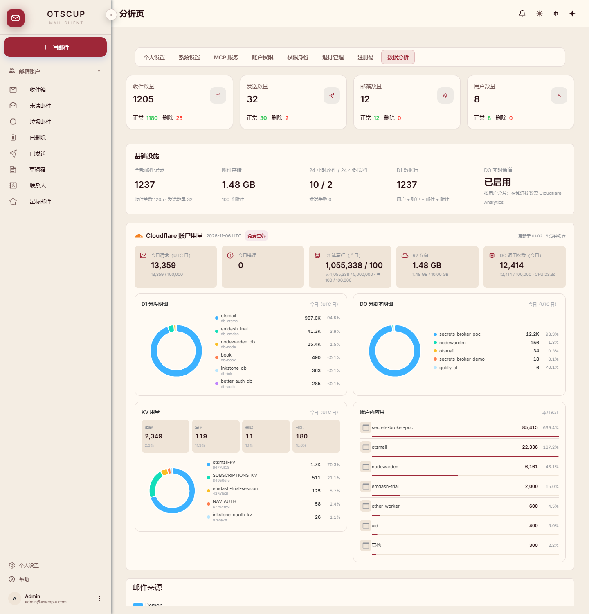

## 架构

```text
Cloudflare Email Routing
         │
         ▼
   otsmail Worker ─────── D1（邮件 / 用户 / 设置 / 权限）
         │
         ├────── KV（缓存 / 验证码 / Push 订阅 / 限流）
         │
         └────── R2（附件 / 背景图 / 前端静态资源）

         ├────── Resend / Cloudflare Email Service（发信）
         ├────── DeepL（翻译）
         ├────── OpenAI 兼容 API / Workers AI（AI）
         ├────── Telegram Bot（远程管理）
         ├────── Durable Object + WebSocket（实时来信）
         └────── FCM HTTP v1（Android 推送）
```

前端是 `mail-vue`（Vue 3 + Element Plus），后端是 `mail-worker`（Hono + Drizzle + Cloudflare bindings）。

## 一键部署到 Cloudflare

点击上面的 Deploy 按钮后，Cloudflare 会克隆仓库、自动创建 D1 / KV / R2，并使用仓库根目录的 `wrangler.toml` 部署。

部署页会提示填写：

- `admin`：管理员登录邮箱
- `domain`：收信域名数组，例如 `["example.com"]`
- `jwt_secret`：随机 64 位十六进制字符串
- `init_secret`：另一个随机 64 位十六进制字符串

部署完成后：

1. 打开 `https://你的域名/setup`，输入 `init_secret` 初始化数据库；
2. 到 Cloudflare Dashboard → Email Routing，把邮箱域名的 catch-all 指向该 Worker；
3. 系统设置里的 `r2_domain` 填 `https://你的域名/oss`，不要绑定公开 R2 自定义域名；附件走 1 小时签名 URL。

> 根目录的 `wrangler.toml` 是给 Deploy 按钮用的模板，不绑定现有生产资源。手动部署前把 `mail-worker/wrangler.toml` 复制为 `mail-worker/wrangler.production.toml`，填入自己的 account_id、D1/KV ID 和域名；该文件已加入 `.gitignore`，不会提交。Deploy 按钮只支持公开的 GitHub/GitLab 仓库。

### Fork 后要改哪里

不要在代码里写自己的域名、邮箱或项目 ID。以下值都在 Cloudflare Dashboard → Worker `otsmail` → Settings → Variables and Secrets 配置：

| 名称 | 类型 | 说明 |
|---|---|---|
| `domain` | Variable (JSON) | 收信域名数组，例如 `["example.com"]` |
| `admin` | Variable | 管理员邮箱，必须与登录账号完全一致 |
| `jwt_secret` | Secret | 随机 64 位十六进制，生成后不要换 |
| `init_secret` | Secret | 首次 `/setup` 使用，初始化后可保留 |
| `VAPID_PUBLIC_KEY` / `VAPID_PRIVATE_KEY` / `VAPID_SUBJECT` | Variable/Secret | Web Push；不需要可留空 |
| `FIREBASE_PROJECT_ID` | Variable | Android FCM 项目 ID；未配置时跳过推送 |
| `FIREBASE_CLIENT_EMAIL` / `FIREBASE_PRIVATE_KEY` | Secret | Firebase service account；私钥只放 Secret |
| `CF_ACCOUNT_ID` | Variable | Cloudflare 账户 ID，数据分析用 |
| `CF_ANALYTICS_TOKEN` | Secret | 账户用量查询；建议给 Account Analytics Read + D1 Read + Workers KV Read |
| `CF_PLAN` | Variable | 可选，`free` / `paid`，用于配额标签覆盖 |
| `WEB_VERSION` | Variable | 可选，Web 版本号，例如 `0.1.97`；用于“检查更新” |
| `WEB_DEPLOYED_AT` | Variable | 可选，部署时间 ISO 字符串 |
| `GITHUB_TOKEN` | Secret | 可选，检查 GitHub Releases 时提高 API 限额 |

FCM 的 service account 私钥只放 Secret，不要写进 `fcm-service.js` 或 `wrangler.toml`。没有 Firebase 配置时，Android 推送直接跳过，不影响收发信。

`CF_ANALYTICS_TOKEN` 没有 D1 / KV 列表权限时，分析页仍能显示用量，但项目名会回退为 UUID 前缀；名称缓存 1 小时。

### 更新检查

系统设置 → “关于与版本” 可查看当前版本和最新 Web Release。更新检查读取 GitHub Releases 中 `web-v*` 标签，使用 30 分钟全局 KV 缓存；不会自动部署，也不会执行自更新。发布 Web 版本时建议：

- 同步 Worker 环境变量 `WEB_VERSION`（“关于与版本”和更新检查比较用的就是这个值，根 `wrangler.toml` 与生产配置各有一份）
- 前端构建读取的是 `VITE_WEB_VERSION`，不是 `WEB_VERSION`；两者别混用
- 打 `web-vX.Y.Z` 标签并创建 GitHub Release
- 部署后在页面点一次“检查更新”（缓存会短暂保留）

## 本地开发

### 环境

- Node.js 20+
- pnpm
- Cloudflare 账户
- 已登录 Wrangler：`npx wrangler login`
- 一个可接入 Cloudflare Email Routing 的域名

### 安装与构建

```bash
cd mail-worker
pnpm install

cd ../mail-vue
pnpm install
pnpm build
```

### 前端开发

```bash
cd mail-vue
pnpm dev
```

默认使用 `.env.dev.local` 指向本地模拟 API。模拟服务：

```bash
python dev/mock-api.py
```

### 测试

```bash
cd mail-worker
pnpm test
```

### 部署

```bash
cd mail-vue
pnpm build

cd ../mail-worker
npx wrangler deploy --config wrangler.production.toml
```

前端构建产物输出到 `mail-worker/dist`，生产静态文件走 Workers Assets；R2 只保留附件/背景图/公共对象，`/oss` 不是附件直链。

可选：设置 `VITE_ONLYOFFICE_URL` 指向你自己的 OnlyOffice 页面，用于 Office 附件编辑；不设置时只提供预览/下载。

## 安全说明

- 登录限速、异常告警、2FA、OIDC PKCE
- DOMPurify 清洗邮件 HTML；公告内容同样清洗
- 参数化 SQL；附件路径白名单
- 管理接口按权限校验；管理员账号使用 `type=0`，不再依赖邮箱字符串绕过
- 公共 API Token 仅管理员可生成，30 天过期
- `/attachments` 使用 1 小时签名 URL；`/oss` 对附件前缀返回 403
- 远程图片/样式默认经签名代理，限制内网地址、重定向、内容类型和大小

## 已知限制

- Cloudflare Workers 无法直接运行 Docker / IMAP / SMTP TCP；外部邮箱聚合需要单独的 IMAP 服务。
- Cloudflare Email Routing 入站上限为 25 MiB；接近上限的邮件解析可能受 Worker 内存限制。
- Android App 被 force-stop 后，FCM 一律不送达，这是系统行为；只能等下次打开 App 拉取。
- D1 免费额度为每日 5,000,000 rows read；计数和列表已做缓存，流量增长后仍建议升级或改增量计数。
- 自定义登录背景图和登录透明度只对 Centered 皮肤生效；Paper / Fresh / Gala 使用各自的背景层。
- 数据分析页的 D1 “查询次数”字段 Cloudflare GraphQL 不提供，只能显示读/写行；D1/KV 名称需要对应列表权限。

## License

MIT。原项目版权归 maillab/cloud-mail 所有。
