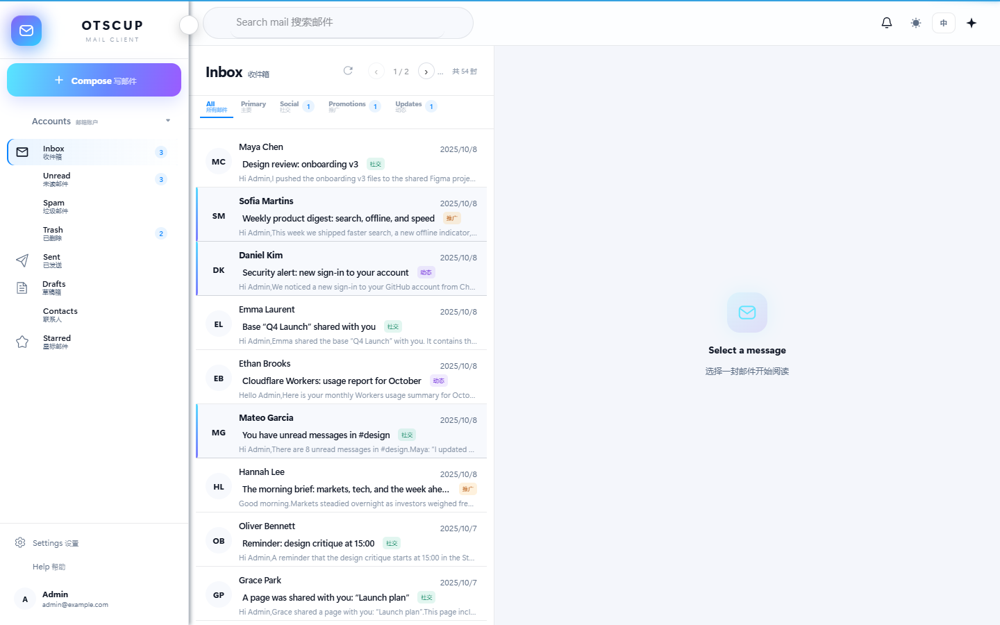
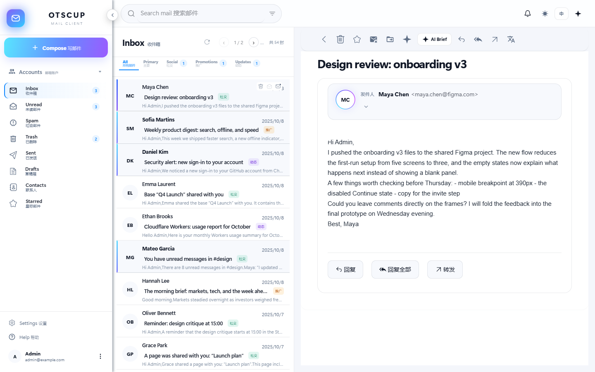
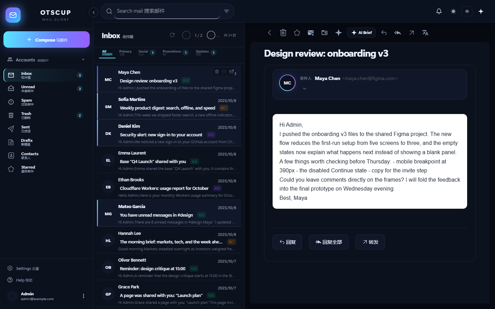
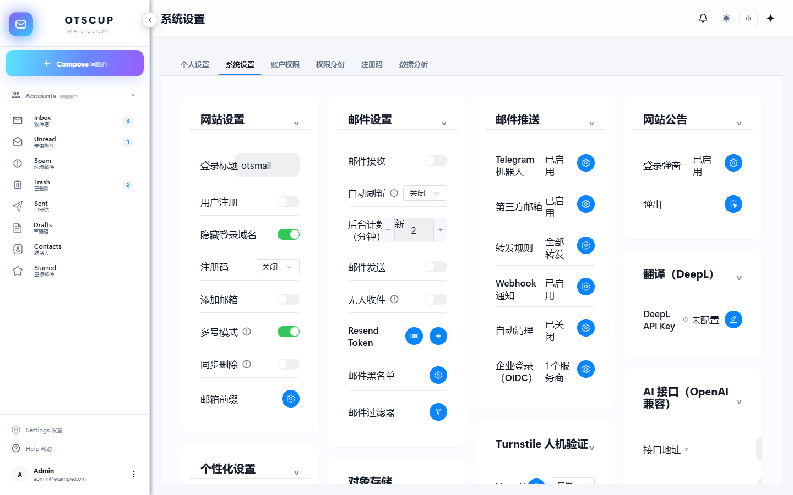
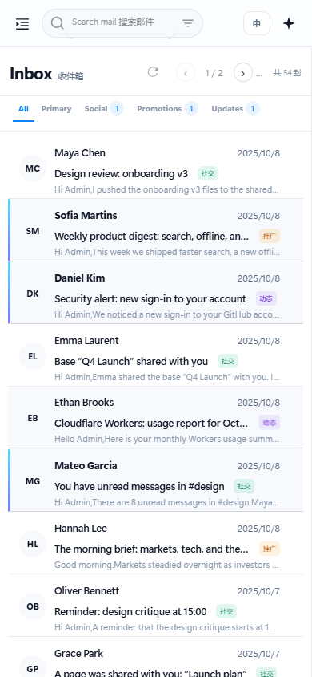

# otsmail

<p align="center">
  
</p>

<p align="center">
  基于 Cloudflare Workers 的自建邮箱系统：Cloudflare Email Routing 收信，Resend / Cloudflare Email Service 发信，D1 + KV + R2 存储。
</p>

<p align="center">
  
  
  
</p>

> Fork 自 [maillab/cloud-mail](https://github.com/maillab/cloud-mail)，保留 MIT 协议与 Cloudflare 原生架构，并在此基础上做了安全加固与功能扩展。

## 功能

| 功能 | 说明 |
|---|---|
| 多邮箱账户 | 同一账号下管理多个邮箱，支持域名、名称、默认发件账号和“所有账户邮件” |
| 邮件列表 | Gmail 风格三栏布局、分类标签、未读计数、分页、搜索高亮、右键多选和批量操作 |
| 阅读器 | 发件人折叠/展开、回复/回复全部/转发、附件、HTML 邮件安全渲染、深色模式 |
| AI 助手 | OpenAI 兼容接口，可配置 Base URL / API Key / 模型；支持摘要、翻译、润色、写信和邮件问答 |
| 自动分类 | 本地规则优先，可切换自动 AI 分类或手动分类；分类可在列表/详情/右键菜单移动 |
| Telegram | 同一个 Bot 接收未读、搜索、已读/未读、删除、归档等指令，也支持自然语言 AI 操作 |
| MCP | 内置 MCP Server，支持 Bearer Token、查询参数 Token 和 OAuth `client_credentials` |
| 安全 | 登录限速、异常告警、2FA、OIDC、PKCE、DOMPurify、参数化 SQL、CORS 白名单、PBKDF2 |
| 通知 | 浏览器桌面通知、提示音、Web Push；通知入口在右上角铃铛菜单 |
| 管理 | 系统设置、账户权限、角色权限、注册码、数据分析；支持按用户独立允许/禁止权限 |

## 截图

### 收件箱



### 邮件详情



### 深色模式



### 系统设置



### 移动端



## 架构

```text
Cloudflare Email Routing
        │
        ▼
   otsmail Worker ────── D1（邮件/用户/设置/权限）
        │       ├────── KV（缓存/验证码/Push 订阅）
        │       └────── R2（附件/背景图/前端静态资源）
        │
        ├── Resend / Cloudflare Email Service（发信）
        ├── DeepL（翻译）
        ├── OpenAI 兼容 API / Workers AI（AI）
        └── Telegram Bot（远程管理）
```

前端是 `mail-vue`（Vue 3 + Element Plus），后端是 `mail-worker`（Hono + Drizzle + Cloudflare bindings）。

## 快速开始

### 环境

- Node.js 20+
- pnpm
- Cloudflare 账号
- 已登录 Wrangler：`npx wrangler login`
- 一个可接入 Cloudflare Email Routing 的域名

### 一键部署（Windows PowerShell）

先在 `mail-worker` 安装依赖：

```powershell
cd mail-worker
pnpm install
cd ..
```

然后执行：

```powershell
powershell -ExecutionPolicy Bypass -File scripts/install.ps1
```

脚本会询问邮箱域名和管理员邮箱，并自动：

1. 创建独立的 D1 / KV / R2；
2. 生成 `mail-worker/wrangler.oneclick.toml`（不会改现有 `wrangler.toml`）；
3. 安装并构建前端；
4. 部署 Worker；
5. 写入 `jwt_secret`；
6. 上传 `mail-worker/dist` 到 R2；
7. 调用 `/api/init/<jwt_secret>` 初始化数据库。

也可以非交互传参：

```powershell
powershell -ExecutionPolicy Bypass -File scripts/install.ps1 `
  -WorkerName otsmail-demo `
  -Domains example.com `
  -AdminEmail admin@example.com
```

只检查参数、不创建资源：

```powershell
powershell -ExecutionPolicy Bypass -File scripts/install.ps1 -DryRun `
  -Domains example.com -AdminEmail admin@example.com
```

> 一键脚本不修改现有 `mail-worker/wrangler.toml`。如果账号里已经有同名 `otsmail` 资源，请换 `-WorkerName`，否则脚本会停止，避免误绑已有邮箱。
>
> Cloudflare 账号没有创建 D1 的权限时，脚本会停在 D1 步骤；这是账号权限问题，不会影响已有站点。

### 手动部署

```bash
git clone https://github.com/otscup/otsmail.git
cd otsmail/mail-worker

npx wrangler d1 create otsmail
npx wrangler kv namespace create otsmail-kv
npx wrangler r2 bucket create otsmail-r2
```

把生成的 D1 / KV / R2 ID 填入 `mail-worker/wrangler.toml`，然后：

```bash
npx wrangler secret put jwt_secret
npx wrangler deploy
cd ../mail-vue
pnpm install
pnpm build
```

前端构建产物会写入 `mail-worker/dist`，随 Worker 一起部署，或上传到 R2 由 Worker 提供静态资源。

首次部署后访问：

```text
https://<你的域名>/api/init/<jwt_secret>
```

然后在 Cloudflare Dashboard → Email Routing 里把邮箱域名的 catch-all 指向 `otsmail` Worker。

### 发信与附件

- 发信需要配置 Resend 或 Cloudflare Email Service 的发信凭据。
- R2 需要绑定公开访问域名，并在后台配置 `r2_domain`；否则附件、背景图和部分静态资源无法显示。
- 自定义域名在 Worker 的 Settings → Domains & Routes 绑定。

## 配置

第一次登录后进入：

`系统设置 / 账户权限 / 权限身份 / 注册码 / 数据分析`

- **系统设置**：站点、注册、邮箱、AI、Telegram、MCP、通知、对象存储。
- **账户权限**：用户列表；每行“操作”→“独立权限”可按用户设置继承/允许/禁止。
- **权限身份**：角色权限、发信额度、发信类型、账户数量、可用域名。
- **数据分析**：收发趋势、分类分布、域名分布。

## 安全说明

- 邮件 HTML 使用 DOMPurify + Shadow DOM，禁止脚本、iframe、表单和危险协议。
- 登录连续失败会锁定并发送 Telegram 告警。
- 密码使用 PBKDF2，Token 存储做了本地加密。
- 支持 2FA、OIDC + PKCE、登录态绑定、账户级独立权限。
- 生产部署请使用独立 `jwt_secret`，不要提交任何密钥或 `.dev.vars`。

## 限制

- Cloudflare Worker 不能直接建立 IMAP/SMTP TCP 连接；如需接入外部邮箱、Docker/Linux 部署，需要单独的 Node 邮件桥接服务。
- Cloudflare Email Service 当前只适合出站发信，不是收件 IMAP 服务。
- D1 免费额度为每天 500 万行读取；邮箱量增大后列表和计数会增长，建议把后台刷新调到 5–15 分钟、使用归档/自动清理，必要时升级 Workers Paid。
- 模板、定时发送、附件预览增强尚未实现。

## 开发

```bash
cd mail-worker && pnpm install && pnpm test
cd ../mail-vue && pnpm install && pnpm build
cd ../mail-worker && npx wrangler deploy --dry-run
```

## License

MIT，见 [LICENSE](LICENSE)。原项目版权归 [maillab/cloud-mail](https://github.com/maillab/cloud-mail) 作者所有。
